# Final Project — Molecular Dynamics

We compute material properties (energy, pressure, temperature) of a two-dimensional system of $N=30$ particles interacting via a **modified Lennard-Jones potential**, using molecular dynamics with periodic boundary conditions and a velocity-Verlet-style integrator.

- **Assignment A** — Zero-temperature energy and pressure as functions of density ($\rho^* = 1.0 \ldots 1.5$).
- **Assignment B** — Pressure and energy as functions of temperature at fixed $\rho^* = 1.1$.

---

## Build & Run

### Prerequisites

- C++17 compiler (g++ or clang++)
- CMake >= 3.15
- Python 3
- pip

### Build

Install the Python dependencies:

```bash
pip install -r requirements.txt
```

Build the C++ extension module:

```bash
mkdir -p build && cd build
cmake ..
make
```

This compiles the `simple_md` Python extension into the `compiled/` directory.

### Run

```bash
python3 run_assignments.py
```

This runs both assignments and saves all output to `figs/`.

---

## Working Formulas

The potential between two particles is the modified Lennard-Jones potential:

$$
\phi=\begin{cases}
\varepsilon\left(-39170.516264\left(\frac{r}{\sigma}\right)^{3}+102795.709007\left(\frac{r}{\sigma}\right)^{2}-90115.812549\left(\frac{r}{\sigma}\right)+26401.649473\right) & \frac{r}{\sigma}\leq0.85\\[6pt]
4\varepsilon\left(\left(\frac{\sigma}{r}\right)^{12}-\left(\frac{\sigma}{r}\right)^{6}\right) & 0.85<\frac{r}{\sigma}\leq1.24445506\\[6pt]
\varepsilon\left(3.2920028\left(r_{m}-\frac{r}{\sigma}\right)^{3}-4.86489008\left(r_{m}-\frac{r}{\sigma}\right)^{2}\right) & 1.24445506<\frac{r}{\sigma}\leq r_{m}\\[6pt]
0 & r_{m}<\frac{r}{\sigma}
\end{cases}
$$

where $r_{m}=1.737051787$.

The force between particles $i$ and $j$ is:

$$
\vec{F}_{ij}=-\vec{\nabla}_{i}\phi\left(r_{ij}\right), \qquad r_{ij}=\|\vec{r}_{i}-\vec{r}_{j}\|
$$

with

$$
\vec{\nabla}_{i}\phi\left(r_{ij}\right)=\hat{r}_{ij}\frac{\partial\phi}{\partial r}\bigg|_{r=r_{ij}}, \qquad \hat{r}_{ij}=\frac{\vec{r}_{i}-\vec{r}_{j}}{r_{ij}}
$$

The derivative of the potential is:

$$
\frac{\partial\phi}{\partial r}=\begin{cases}
\frac{\varepsilon}{\sigma}\left(-3\times39170.516264\left(\frac{r}{\sigma}\right)^{2}+2\times102795.709007\left(\frac{r}{\sigma}\right)-90115.812549\right) & \frac{r}{\sigma}\leq0.85\\[6pt]
\frac{4\varepsilon}{\sigma}\left(6\left(\frac{\sigma}{r}\right)^{7}-12\left(\frac{\sigma}{r}\right)^{13}\right) & 0.85<\frac{r}{\sigma}\leq1.24445506\\[6pt]
\frac{\varepsilon}{\sigma}\left(-3\times3.2920028\left(r_{m}-\frac{r}{\sigma}\right)^{2}+2\times4.86489008\left(r_{m}-\frac{r}{\sigma}\right)\right) & 1.24445506<\frac{r}{\sigma}\leq r_{m}\\[6pt]
0 & r_{m}<\frac{r}{\sigma}
\end{cases}
$$

### Dimensionless Quantities

In the solver we use:

$$
r^{\star}=\frac{r}{\sigma},\quad \phi^{\star}=\frac{\phi}{\varepsilon},\quad \frac{\partial\phi^{\star}}{\partial r^{\star}}=\frac{\sigma}{\varepsilon}\frac{\partial\phi}{\partial r},\quad L^{\star}=\frac{L}{\sigma},\quad K^{\star}=\frac{K}{\varepsilon}
$$

$$
p^{\star}=\frac{\sigma^{2}}{\varepsilon}\,p,\qquad T^{\star}=\frac{K^{\star}}{N}
$$

### Pressure

The pressure is calculated by:

$$
p=\frac{1}{V}\left(\sum_{j>i}\vec{r}^{\,n}_{ij}\cdot\vec{F}^{\,n}_{ij}+m\sum_{i}\left(v^{n}_{i}\right)^{2}\right)
$$

where the first term becomes:

$$
\vec{r}^{\,n}_{ij}\cdot\vec{F}^{\,n}_{ij}=-\vec{r}^{\,n}_{ij}\cdot\hat{r}_{ij}\frac{\partial\phi}{\partial r}\bigg|_{r=r_{ij}}=-r_{ij}\frac{\partial\phi}{\partial r}\bigg|_{r=r_{ij}}
$$

---

## Assignment A: Zero-Temperature Energy and Pressure vs. Density

We place $N=30$ particles on a triangular lattice with zero initial velocity, and minimize the energy by running the simulation for $10^5$ time steps ($dt^*=10^{-3}$). The reduced density $\rho^*$ ranges from 1.0 to 1.5 in steps of 0.05.

### Results

| $\rho$ [g/cm²] | $E/N$ [erg] | Pressure [dyn/cm] |
|---|---|---|
| 2.075000e-07 | -1.590642e-12 | 1.767860e+04 |
| 2.178750e-07 | -9.579191e-13 | 3.612079e+04 |
| 2.282500e-07 | -5.042868e-13 | 5.256030e+04 |
| 2.386250e-07 | 4.605242e-13 | 7.930858e+04 |
| 2.490000e-07 | 1.822821e-12 | 1.169035e+05 |
| 2.593750e-07 | 3.744110e-12 | 1.689321e+05 |
| 2.697500e-07 | 6.131780e-12 | 2.350635e+05 |
| 2.801250e-07 | 9.291843e-12 | 3.230567e+05 |
| 2.905000e-07 | 1.326199e-11 | 4.348546e+05 |
| 3.008750e-07 | 1.819861e-11 | 5.723621e+05 |
| 3.112500e-07 | 2.431798e-11 | 7.367325e+05 |

### Pressure vs. Density

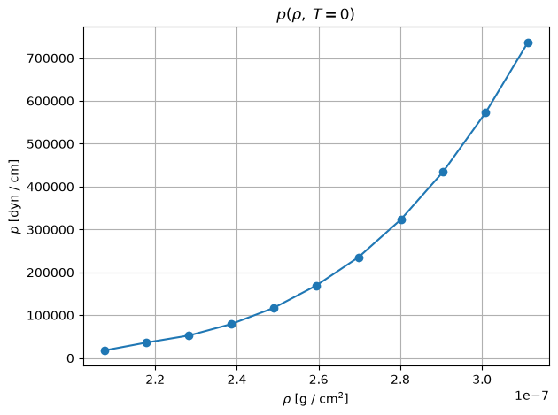

### Position Snapshots (Assignment A)

| $\rho^* = 1.00$ | $\rho^* = 1.25$ | $\rho^* = 1.50$ |
|:---:|:---:|:---:|
| 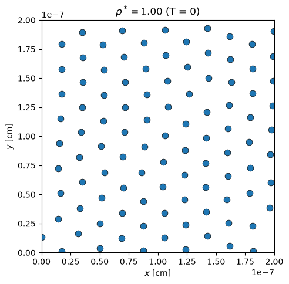 | 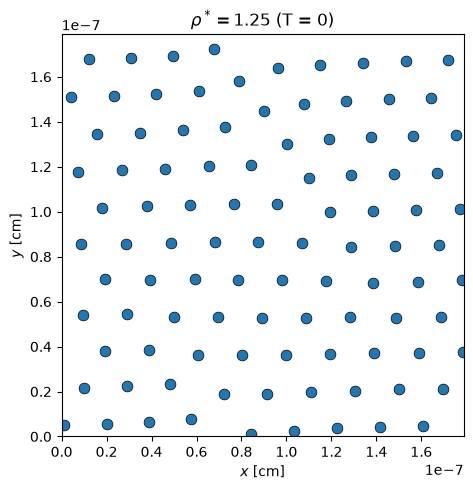 | 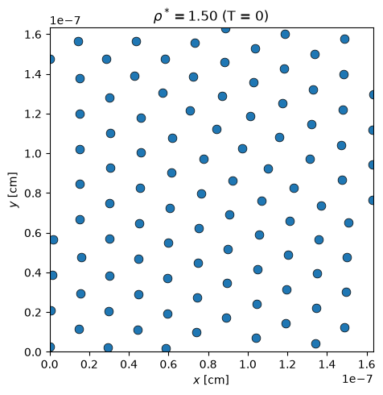 |

---

## Assignment B: Pressure and Energy vs. Temperature

We fix $\rho^* = 1.1$ and assign random initial velocities scaled by 15 energy values. For each energy, we relax for $5\times10^4$ steps, then average observables over the next $5\times10^4$ steps.

### Results

| $E/N$ [erg] | Pressure [dyn/cm] | Temperature [K] |
|---|---|---|
| -4.904783e-13 | 5.262456e+04 | 109.5 |
| -4.352706e-13 | 5.322910e+04 | 310.0 |
| -3.662783e-13 | 5.397842e+04 | 560.6 |
| -2.282409e-13 | 5.546871e+04 | 1063.7 |
| 4.768452e-14 | 5.730724e+04 | 2356.4 |
| 7.298952e-13 | 6.459273e+04 | 4903.3 |
| 1.963751e-12 | 7.750447e+04 | 9612.3 |
| 3.214486e-12 | 9.051360e+04 | 14408.9 |
| 4.492719e-12 | 1.032922e+05 | 19425.4 |
| 5.683442e-12 | 1.156799e+05 | 23841.5 |
| 1.051571e-11 | 1.660867e+05 | 41668.6 |
| 1.560177e-11 | 2.124171e+05 | 64050.0 |
| 2.245744e-11 | 2.714495e+05 | 96223.6 |
| 3.249985e-11 | 3.529539e+05 | 145380.7 |
| 4.695147e-11 | 4.628548e+05 | 217561.3 |

### Pressure vs. Temperature

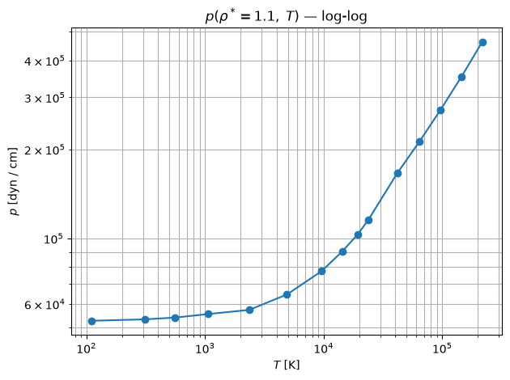

### Energy vs. Temperature

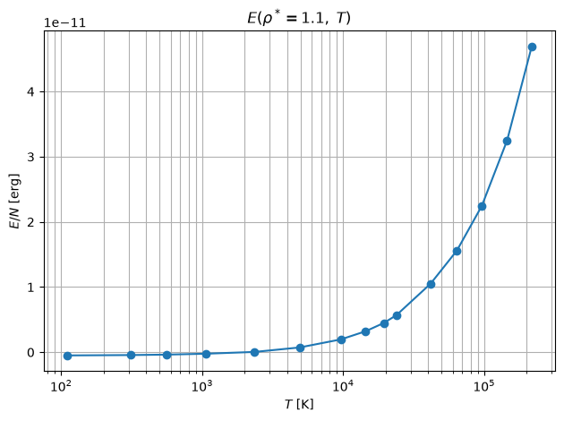

### Position Snapshots (Assignment B)

| $T_0$ | $T_1$ | $T_2$ |
|:---:|:---:|:---:|
| 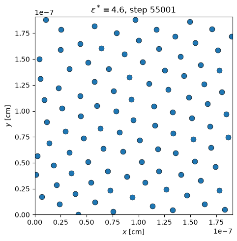 | 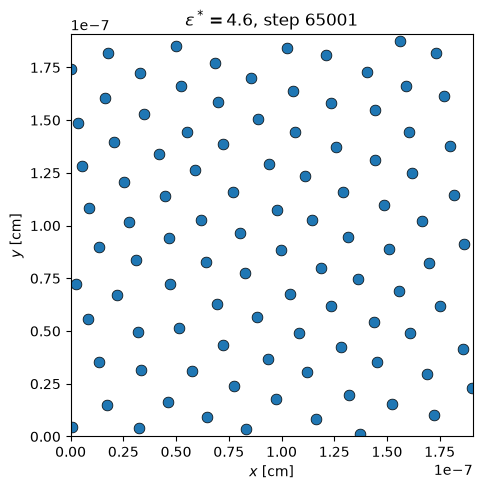 | 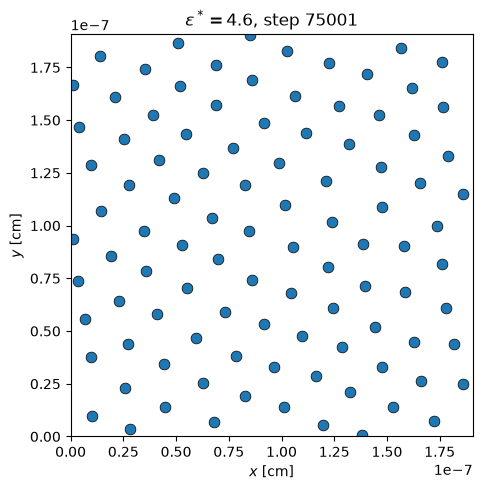 |

| $T_3$ | $T_4$ |
|:---:|:---:|
| 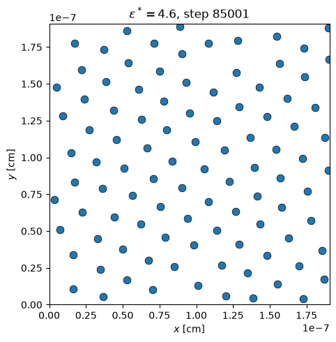 | 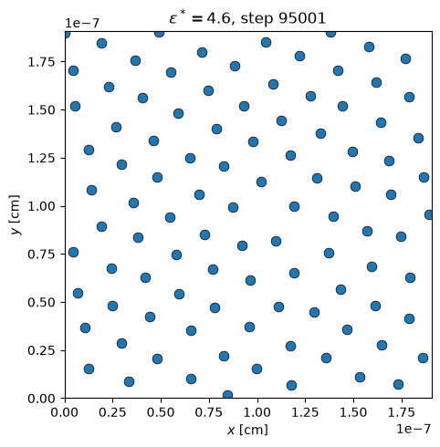 |

---

## Project Structure

```
├── CMakeLists.txt          # Builds the pybind11 extension
├── requirements.txt        # Python dependencies
├── run_assignments.py      # Main entry point (Assignments A & B)
├── compiled/               # Built extension module (simple_md.so)
├── src/
│   ├── cpp/
│   │   ├── Vector2D.hpp            # 2D vector arithmetic
│   │   ├── Particle.hpp / .cpp     # Per-particle state
│   │   ├── PotentialsAndForces.hpp # Modified LJ potential and forces
│   │   ├── MDSimulation.hpp / .cpp # Integrator, BCs, observables
│   │   └── bindings.cpp            # pybind11 bindings
│   └── python/
│       └── simulation.py           # High-level drivers and unit conversion
├── plots/
│   └── plotting.py                 # Matplotlib plotting utilities
└── figs/                           # Generated figures
```
